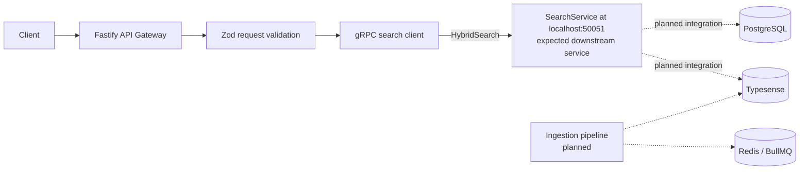

# Nexus Search

> **Status: Experimental / work in progress.** Nexus Search is a prototype for a service-oriented hybrid-search system. The repository contains the API gateway, search request contract, gRPC client integration, local infrastructure, and design notes. A complete end-to-end search and ingestion deployment is still being built.

Nexus Search explores a search API that can combine lexical relevance (BM25) with vector similarity, with a tunable weight between the two retrieval signals.

## What is in the repository today

- **Fastify API gateway** organised around plugins and versioned domain modules.
- **Search endpoint** with Zod validation for `query`, `k`, and `alpha`.
- **gRPC client integration** using `@grpc/grpc-js` and shared Protocol Buffer contracts.
- **Shared contracts** for `HybridSearch` and ingestion RPCs in `packages/proto`.
- **Local infrastructure** provisioned through Docker Compose: PostgreSQL, Redis, and Typesense.
- **Engineering notes** covering distributed-systems concepts, Docker networking, API design, and service boundaries.

## Architecture



The API gateway currently calls a gRPC service at `localhost:50051`. The Protocol Buffer contract and client are in this repository; the corresponding complete search-service server is not currently included here. The local Compose file provisions PostgreSQL, Redis, and Typesense, but their presence does not imply that the end-to-end indexing pipeline is complete.

## Search contract

The REST search request is validated with the following fields:

| Field | Meaning | Validation |
|---|---|---|
| `query` | Text to search for | Non-empty string |
| `k` | Requested result count | Integer from 1 to 50; defaults to 10 |
| `alpha` | Weight between vector and BM25 signals | Number from 0 to 1; defaults to 0.5 |

The shared `SearchService.HybridSearch` Protocol Buffer RPC accepts the query, top-`k` value, and alpha weight, and returns document hits.

## Repository layout

```text
.
├── apps/
│   └── api-gateway/
│       └── src/
│           ├── modules/v1/       # versioned health and search modules
│           └── plugins/          # security, error handling, shutdown
├── packages/
│   └── proto/src/                # search.proto and ingest.proto
├── data/                         # local data / seed assets
├── docs/
│   ├── distributed-systems/
│   ├── infrastructure/
│   ├── code-explanations/
│   └── learning_log.md
└── docker-compose.yml
```

## Technology

- TypeScript and Node.js
- Fastify, Zod, and Pino
- gRPC, Protocol Buffers, and `@grpc/grpc-js`
- pnpm workspaces and Turborepo
- PostgreSQL, Redis, and Typesense (local Compose dependencies)
- Docker Compose

## Run locally

### Prerequisites

- Node.js
- pnpm 9
- Docker and Docker Compose

### Start local dependencies

```bash
docker compose up -d
docker compose ps
```

### Install and run the workspace

```bash
pnpm install
pnpm dev
```

Build the workspace with:

```bash
pnpm build
```

The gateway's gRPC client currently targets `localhost:50051`; a compatible search-service server must be running there for the search request to complete successfully. Starting the Compose dependencies alone does not start that server.

## Security and deployment notes

The current gateway security plugin registers Helmet, CORS, and rate limiting. CORS is configured with a wildcard origin in the current source and must be restricted to intended clients before any public deployment. The sample Compose credentials and local service configuration are for development, not production use.

## Roadmap

- Implement and run the gRPC search-service server.
- Connect the server to Typesense and validate lexical/vector retrieval behaviour.
- Implement the ingestion pipeline and document lifecycle.
- Add end-to-end tests covering indexing, search, and failure scenarios.
- Add measured relevance and latency evaluation with a documented dataset and environment.
- Tighten CORS, secret handling, observability, and deployment configuration.

## Engineering notes

The `docs/` directory records design reasoning and implementation walkthroughs alongside the code. The aim is to keep architectural choices inspectable rather than presenting a diagram without the decisions behind it.
